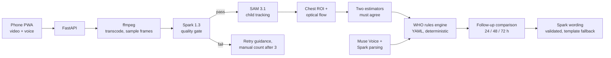

# Pneumonion

**Point a phone at a sick child's chest for a minute. Get a breathing rate, a WHO-style triage result, and a follow-up plan, in the caregiver's own language.**

Built for the Meta Global AI Developer Hackathon (Indie developer track) on Meta's SAM 3.1, Muse Spark 1.3 and Muse Voice Transcribe.

[Live app](https://pneumonion.fly.dev) · [3-minute demo video](https://youtu.be/BVwacUfHKTY?si=ClQmMLC4CnwktpFY) · Access code: provided to judges in the hackathon submission

> **Triage support, not a diagnosis.** Pneumonion is a hackathon prototype. Its rules are drafts that no clinician has reviewed, and it has not been validated on children. See [Limits](#limits-and-what-comes-before-real-use).

---

## The problem

Pneumonia is one of the leading infectious causes of death in children under five, and most of those deaths are preventable with timely care. The WHO's IMCI protocol catches many cases with a simple check: count how many breaths the child takes in a full minute and compare it with an age-based limit (60 for infants under two months, 50 for 2 to 11 months, 40 for 12 to 59 months), then ask about danger signs.

That check is hard to do well. Counting breaths on a restless toddler for 60 seconds is error-prone, and many caregivers who need the advice are not near a trained health worker. Follow-up matters just as much: a child who is not improving by day 3 needs to be seen, and that is the step most easily lost.

Pneumonion puts the count, the danger-sign questions, the triage rule and the 24/48/72-hour recheck plan on the phone a caregiver already has.

**Hackathon problem statement: Build for Your World.** Pneumonion brings Meta's models to child health at home. A caregiver with only a phone gets a breath count, danger-sign triage and a recheck plan in their own language, a check that until now needed a trained health worker counting by hand.

## What it does

1. **Capture.** The caregiver picks the child's age and language, answers the danger-sign questions (by tapping or by speaking), and records 60 seconds of video of the child's chest.
2. **Check the recording.** Muse Spark looks at sampled frames and reports what is visible: is the child in frame, is the chest uncovered, is the child calm, is the camera steady, is the light good. If anything fails, the app says what to fix and asks for a retake. After three failed tries it switches to a guided manual count.
3. **Find the chest.** SAM 3.1 tracks the child through the video. The app takes the upper-torso region from the mask on every frame, so the measurement follows a baby who shifts, not a fixed box on the screen.
4. **Measure breathing.** Optical flow inside that region, minus the flow of the surrounding background to cancel camera shake, gives a chest-motion signal. Two independent estimators (peak spacing and spectral peak) each produce a rate. If they disagree, or the signal is weak, the app reports no reading instead of a guess.
5. **Triage.** A small rules engine reads versioned YAML files built from the WHO IMCI chart and returns one of five classes, from *go to a health facility now* to *no signs found in this check*.
6. **Explain.** Muse Spark rewrites the result as plain, calm advice in the caregiver's language. The English action line always stays on screen.
7. **Follow up.** The app schedules rechecks at 24, 48 and 72 hours (with calendar reminders), then compares each new result with the last one and with day 0. It flags improving, not improving, worse or urgent.

## How it uses Meta's models

Each model has one narrow job, and in every case code checks the output before anything reaches the caregiver. **No model ever chooses the triage class.** The rules engine does.

| Model | Job in Pneumonion | What stops it going wrong |
|---|---|---|
| **SAM 3.1** (video segmentation, Responses API) | Tracks the child frame by frame and supplies a mask that defines the chest region for motion analysis. | Frames with low confidence or sudden mask-size jumps are dropped. If tracking fails, the recording is rejected as unreliable. |
| **Muse Spark 1.3** | (a) Quality gate on sampled frames. (b) Turns a spoken answer into yes/no/unclear for each danger sign. (c) Writes the advice in the caregiver's language. | (a) The model only reports what it sees; code decides pass or fail, and anything malformed fails closed. (b) The model must quote the caregiver's words, and code checks the quote appears in the transcript. A missing or unmatched quote becomes "unclear" and is re-asked by tap, never assumed to be "no". (c) Output is screened for dosing and diagnosis language and replaced by a fixed template if it slips. |
| **Muse Voice Transcribe 1.0** | Lets a caregiver answer the questions aloud instead of tapping. | Transcripts are treated as untrusted text. The model prompt says to ignore instructions inside them, and every parsed answer is re-validated against the transcript. |

Two details worth knowing:

- Spark is called in Standard mode only, with `store=False` and a keyed-hash `safety_identifier`. The code asserts the model name never ends in `-contributor`, so child data cannot reach a contributor-mode model.
- SAM is used as a measuring instrument inside a classical signal-processing pipeline, not as a demo of segmentation. The repo includes an ablation (`--tracks box` vs `--tracks api`) that compares a fixed region with the SAM-tracked region on the same clips, so its contribution is measured.

## Architecture



## Engineering decisions

**Refusing is a feature.** A wrong count on a sick child is worse than no count. The app declines to give a rate when the quality gate fails, when SAM finds no child, when too few frames are usable, when the motion signal is too weak to be a real chest (a pillow on a still surface should not read as a patient), or when the two estimators disagree by more than 4 breaths per minute. The stress-clip set in the evaluation (blanket, dark room, walking, occluded chest, empty frame, still doll) tests exactly this.

**Rules are data, not code.** Thresholds, actions, return precautions and follow-up timing live in `api/rules/*.yaml`, each file carrying a version and its guideline citation. A clinician can review and change them without reading Python.

**Silence is never "no".** In the voice interview, an unclear or unsupported answer is returned to the caregiver as a tap question. Every danger-sign field is required, so the API rejects incomplete answers.

**Borderline counts trigger a repeat.** A rate within 3 breaths of a limit tells the caregiver to repeat the check instead of picking a side.

**Privacy by construction.** Raw video is deleted as soon as the measurement is done, and the uploaded file is deleted from Meta's side after tracking. Only derived numbers are stored, for 14 days. Cases are keyed by a hash of a random token held on the caregiver's device (HMAC with a server secret); the same hash is used as the Meta safety identifier. Logs never contain video, transcripts or keys.

**Cost and abuse limits.** The API is closed unless an access code is configured, with per-IP hourly limits, a daily cap on assessments and a cap on concurrent jobs. SAM dominates the cost at roughly $0.12 per 60-second clip.

**Tested.** 78 tests cover the rules, breath estimation, follow-up logic, voice and interview validation, and the API paths. The deployed app has also been tried by hand on real iOS Safari and Chrome on Android devices, including camera and microphone capture, in low light and with thick clothing.

## Evaluation

**Status: the measurement harness is built, but the accuracy study has not been run.** This README reports no accuracy numbers because none exist yet, and the app should not be assumed accurate on real children.

What exists today:

- `eval/` measures the breath-rate estimator against two independent human counters, with a `dev`/`test` split so thresholds are tuned on one set and reported on the other. It also includes the SAM ablation (`--tracks box` vs `--tracks api`), which compares a fixed chest region with the SAM-tracked one on the same clips.
- `eval/PROTOCOL.md` is the recording plan: 15 paced-breathing clips around the 40 and 50 limits, 6 stress clips that must be refused (blanket, dark room, walking, occluded chest, empty frame, still doll), and 2 realistic handheld clips that must be accepted. The protocol sets pass targets before any run, and requires the held-out `test` split to be run once and reported as is.
- Synthetic clips from `eval.make_synthetic` check that the harness works. They are never reported as results.
- The estimator's refusal logic is covered by unit tests, and the deployed app has been tried by hand on real phones (see [Limits](#limits-and-what-comes-before-real-use)).

The first planned study uses adult volunteers breathing to a metronome. That tests the algorithm, not infants or sick children, and with a small number of clips it supports "works on these clips" rather than a claim of clinical accuracy.

## Run it

```bash
pip install -r requirements.txt pytest
sudo apt install ffmpeg
python -m pytest -q                       # about a minute

export MODEL_API_KEY=...                  # Meta Model API key
export ACCESS_CODE=...                    # the API stays closed without one
export PSEUDO_SALT=$(openssl rand -hex 32)
uvicorn api.main:create_app --factory --port 8080
```

The camera and microphone need HTTPS, so use the Fly URL or a tunnel when testing on a phone. The repo ships a `Dockerfile` and `fly.toml` for Fly.io. Before deploying, `python -m scripts.live_check --clip <clip.mp4> --wav <answer.wav>` calls all three Meta endpoints once and reports whether each response was parsed.

To show the follow-up flow without waiting three days, set `DEMO_MODE=1` and call `POST /api/demo/clock {"offset_hours": 73}`.

## Repo map

```
api/
  main.py          FastAPI app, access control, rate limits
  jobs.py          assessment pipeline and job lifecycle
  gate.py          retry policy, manual-count fallback
  meta/            SAM, Spark (gate, interview, guidance), Voice clients
  breath/          chest ROI from SAM masks, optical flow, rate estimation
  rules/           WHO IMCI and follow-up rules (YAML) and the engine
  followup/        day-over-day comparison, schedule, .ics reminders
  store/           SQLite storage with 14-day expiry
web/dist/          installable PWA (single file, no build step)
eval/              evaluation harness and recording protocol
tests/             78 tests
```

## Limits and what comes before real use

This is a prototype. Before anyone relies on it for a real child:

1. A clinician signs off the rules in `who_imci.yaml` and `who_followup.yaml`, the return precautions, and the classification used for chest indrawing.
2. The estimator thresholds (`min_rms`, `min_peak_ratio`, `agree_bpm`) are calibrated on real clips, then validated on infants and young children under ethics approval and with guardian consent.
3. Native speakers review the advice in every supported language. The interface itself is English only; advice is generated in nine languages today (English, Hindi, Spanish, French, Portuguese, Arabic, Bengali, Indonesian, Vietnamese), although the voice model supports more.
4. Systematic device and condition testing. The app has been tried by hand on real phones (iOS Safari and Chrome on Android), in low light and with thick clothing, but not with a structured protocol, and not with small infants.
5. Privacy and legal review. Job state lives in SQLite on a single machine, so there is no redundancy.

Known gaps: no illustration for chest indrawing, no UI translations, no read-aloud for questions, no offline mode, no per-case rate limits.

## License

See [LICENSE](LICENSE).
